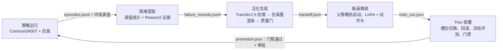

# 工作流：五段怎么接、模型怎么嵌、产物怎么交接

本文按代码说明闭环的实际结构。安装步骤见 [installation.md](installation.md)，运行命令见 [runbook.md](runbook.md)，文件格式见 [contracts.md](contracts.md)。

RSI 在本项目中指策略运行产生反馈、反馈改变训练数据、候选经冻结评测与审批晋升后重新采集下一圈。项目已实现这些工程接口，已有实验的统计门禁结论为拒绝，尚未完成生产晋升或证明连续多圈改善。判官只提供诊断，仿真成败由环境真值决定。



## 1. 一台 Thor 怎么同时容纳这些模型

不同时容纳。所有模型阶段严格串行，规则写在代码里：

- **四个 venv**：`envs/policy`（策略、Reason2 判官、训练）、`envs/sim`（LIBERO/MuJoCo worker）、`envs/transfer`（Cosmos-Transfer2.5）、`envs/predict`（Cosmos-Predict2.5）。依赖互不污染。
- **一段一个进程组**：`p0_feedback_chain.execute_stage` 和 `p1_predict_validation.execute_probe` 都先调 `ensure_gpu_idle()`，再用 `start_new_session=True` 起子进程。结束后 `stop_process_group` 先发 SIGTERM，宽限期后发 SIGKILL，整组清理。

```python
def ensure_gpu_idle() -> None:                       # scripts/p0_common.py
    busy = command(["nvidia-smi", "--query-compute-apps=pid,process_name", "--format=csv,noheader"])
    if busy.get("returncode") != 0 or busy.get("stdout"):
        raise RuntimeError(f"GPU 占用检查未通过：{busy}")
```

- **整圈互斥**：`rsi/loop.py` 对 `runs/.rsi_iteration.lock` 加 `flock`；`p1_feedback_generation.py` 拿不到同一把锁就拒绝抢占。
- **只交文件**：每段把产物写进自己的 `runs/p0/<阶段>_<时间>/`，并写 `probe.json`（阶段、状态、墙钟、全机内存峰值、源码快照）。下游读取前核对 SHA256。

## 2. 编排：`rsi/loop.py`

一圈 12 个 `stage()`，按顺序执行：

```
feedback → feedback_materials → data_qualification → train_candidate → train_control → train_analytic_ablation
→ deployment_smoke → evaluate_candidate → analysis_candidate → evaluate_control → analysis_control → evaluation_gate
```

`stage()` 有两种走法：

- 阶段已完成：核对已有产物的 SHA256 后直接复用。
- 阶段未完成：调用 `execute_stage` 起子进程。

进度写进 `iteration_state.json`。工程失败后用同样的输入加 `--resume-from <上次的 rsi_iteration 目录>` 续跑，只复用摘要和阶段校验都通过的产物。训练段的三个角色说明如下：

- `candidate`：本圈数据。
- `control`：只用 D0 的复制对照，训练量相同。
- `analytic_ablation`：解析纯色外观消融。

三个角色从同一父权重出发，用同一预算各训一份，用来区分“新数据的作用”和“多训几步的作用”。

## 3. 五段逐段

### 3.1 策略运行

- 入口：`p0_feedback_chain.py` 的第一步 `p0_feedback_rollout.py`。策略服务 `p0_policy_server.py` 在 `envs/policy` 中常驻本机端口，仿真 worker 在 `envs/sim` 中运行。
- 配置：`configs/rollout_budget.yaml`（条件、每条件回合数、初态与策略种子）。
- 策略模型（`p0_policy_runtime.build_model`）：

```python
config = config or OmegaConf.create({"framework": {"name": "CosmosGR00T",
    "qwenvl": {"base_vlm": str(base_model), "attn_implementation": "sdpa"},     # base_vlm = Cosmos-Reason2-2B
    "action_model": {"state_dim": 8, "action_dim": 7, "action_horizon": 8}}, …})
model = Cosmos_GR00T(config).to("cuda")
```

- 服务端每次请求固定噪声种子，调 `model.predict_action`，得到 8×7 动作块；仿真按 20 Hz 逐行执行。同一观测必给同一动作，部署段的回滚校验依赖这一点。
- 产出：`feedback_rollout.json`、`episodes.jsonl`（每回合的 `environment_truth`），以及每个视角的关键帧。

### 3.2 困难提取

- **判官** `p0_feedback_judge.py`（`envs/policy`，vLLM，必须开 CUDA Graph）：
  - 加载 `checkpoints/base/Cosmos-Reason2-2B`，配置 `configs/judge_calibration.yaml`。
  - 每回合取初始、中段、最终三个时刻 × 两个视角的关键帧，一次推理得到 JSON 判词。
  - 原始输出逐回合写进 `responses/`，汇总在 `verdicts.jsonl` 与 `judge_report.json`。
  - 判官没有校准达标，只作证据，不覆盖环境真值。
- **挖掘** `p0_feedback_mine.py`（`configs/mining.yaml`）：
  - 成败只看环境真值。按“任务 × 条件”统计失败率和 Wilson 区间。
  - 路由规则：光照或背景扰动组失败率区间的下界高于标准组上界，且两组回合数都达到下限时，判为视觉弱点，路由 `cosmos_restyle`；困难成功的回合路由 `self_distill`；其余路由 `ignore`。
  - 产出：`mining_report.json`、`failures/failure_records.jsonl`。
- 链路汇总写在 `feedback_chain.json`，里面记录三步产物的路径与 SHA256。`p0_feedback_materials.py` 用 CPU 导出终帧、逐回合 CSV 和成败视频。

### 3.3 泛化生成

失败回合只决定“补哪种条件”，动作监督永远来自成功轨迹。

**Transfer2.5 原生调用**：`p0_transfer_smoke.generate`，运行在 `envs/transfer`。

- 用蒸馏版 `edge/distilled` 模型，4 步，93 帧窗口，seed 42。
- 控制信号是 edge，加场景 mask；提示词只允许改桌面。
- `p1_feedback_generation.py` 有两步：`prepare` 把失败记录绑定到同任务成功示范；`generate` 调用原生推理。
- 原生输出会改动机械臂和物体，所以报告固定写 `eligible_for_training: false`。

```python
from p0_transfer_smoke import generate as transfer_generate          # scripts/p1_feedback_generation.py
args = SimpleNamespace(spec=input_path.parent / "spec.json", num_steps=4, model="edge/distilled", …, seed=42)
native = transfer_generate(directory, args)
```

**进训练的路线**：只取 Cosmos 的桌面纹理，画面由仿真按原状态重画。

| 顺序 | 入口 | 作用 |
| --- | --- | --- |
| 1 | `p0_table_texture_design.py` | 从原生输出裁出桌面纹理并归一化 |
| 2 | `p0_table_uv_atlas_design.py` | 把纹理按固定密度铺进桌体 UV 图集 |
| 3 | `p0_table_uv_validation.py`（`p0_run_uv_validation.sh`） | MuJoCo 按成功示范的同一状态逐帧重渲染；用设计源和独立源做正负控制 |
| 4 | `p0_uv_window_gate.py --role design\|heldout` | 质量门（`configs/gen_gate.yaml`）：像素证书（只有桌体像素可变）、桌面时序残差 p95 ≤ 0.08、三项复核绑定视频 SHA；零拒绝原因才准入 |
| 5 | `p0_lerobot_handoff.py --parent … --gate …` | 把准入窗口写成无损 LeRobot v3，并用 starVLA 原生读取器逐窗口回读，产出 `handoff.json` |

**Predict2.5（离线分支）**：`p1_predict_validation.py` 用 `execute_probe` 在三个环境里依次起子进程。

| 环境 | 入口 | 作用 |
| --- | --- | --- |
| `sim` | `p0_predict_transition.py` | 重放同一状态的动作分支，取得物理真值 |
| `policy` | `p0_predict_embeddings.py` | 计算语言条件 |
| `predict` | `p0_predict_smoke.py` | 用 Cosmos-Predict2.5-2B LIBERO policy 分支预测 t+16 双视角端点 |

产出 `predict_report.json`，其中 `advisory_only: true`，不进训练也不进规划。

```python
command = [str(ROOT / "envs" / environment / "bin/python"), "-u", str(ROOT / "scripts" / script),
           *map(str, arguments)]                                     # scripts/p1_predict_validation.py
```

### 3.4 极速微调

- **数据准入**：`p1_policy_update.py --prepare-only`（loop 中的 `data_qualification`）按预算配额混合三类成功数据，产出 `prepared_data.json`。
  - D0：原始成功示范，用来保住原有能力。
  - S_k：本圈环境判成功的回合。
  - G_k：`handoff.json` 中过了质量门的 Cosmos 外观窗口。
- **训练**：`p1_policy_update.py --role <角色>`，从父权重热启动。
  - `build_model(…, "lora")` 重建同一结构。
  - `restore_checkpoint` 恢复 LoRA、动作头权重和 AdamW 状态。
  - 只训 LoRA（`r=8`，q/v 投影）和动作头，骨干原权重不动。
  - 学习率和步数由预算配置给出（如 `configs/iteration_budget_conservative_formal.yaml`）。
- **产出**：`train_run.json`（`output_ckpt` 与 `output_ckpt_sha256`）；检查点目录含 `checkpoint.json` 与 `state.pt`。

### 3.5 Thor 部署与门禁

- **部署演练** `p0_augmented_deploy_smoke.py`：只用独立服务槽位，按顺序做三步：
  1. `current` 指向父权重，预热后测基线；
  2. 原子替换软链接切到候选；
  3. 切回父权重。

  回滚后同一观测的动作必须逐值相同（`np.array_equal`）。产出 `deployment_smoke.json`。
- **冻结评测**：`p0_evaluate_policy.py` 在 `eval/frozen_eval_set.json` 上跑完整回合，`p0_analyze_evaluation.py` 出图表。
- **门禁** `p1_eval_gate.py`：
  - 从逐回合环境真值重新计数。
  - 核对父权重、计划、冻结集身份、上游版本和运行条件。
  - 检查候选相对对照的增益、非目标回退和部署延迟。
  - 输出 `iter.json`（`decision`、`eligible_for_promotion`）。
- **晋升** `p1_promote.py`：
  - 必须给出 `--gate`、`--approve-gate-sha256`、`--approval-reference`。审批引用由人填写，代理不能自批。
  - 权重保存到 `checkpoints/promoted/iterNNN_<hash>/`，`checkpoints/current` 与 `previous` 原子切换，然后做生产冒烟。
  - 失败时恢复原链接并写 `rollback.json`；成功写 `promotion.json`。
  - 下一圈用 `--parent-promotion` 接上。

## 4. 三个 Cosmos 模型的嵌入点

| 模型 | 所在阶段 | 进程与环境 | 读 | 写 | 是否进训练 |
| --- | --- | --- | --- | --- | --- |
| Cosmos-Reason2-2B（策略骨干） | 策略运行、极速微调 | `envs/policy`，`p0_policy_runtime.build_model` | 双视角、状态、指令 | 动作块；LoRA 权重 | 是（骨干冻结，只训 LoRA） |
| Cosmos-Reason2（判官） | 困难提取 | `envs/policy`，`execute_stage(…, "p0_feedback_judge.py", …)` | 关键帧 | `verdicts.jsonl`、`judge_report.json` | 否，只作证据 |
| Cosmos-Transfer2.5 | 泛化生成 | `envs/transfer`，`p0_transfer_smoke.generate` | 成功示范、edge、mask | 原生窗口 → 纹理 → 重渲染窗口 | 只有过质量门的重渲染窗口经 `handoff.json` 进入 |
| Cosmos-Predict2.5 | 离线分支 | `envs/predict`，`execute_probe(…, "predict", "p0_predict_smoke.py", …)` | 当前双视角、状态、动作块 | `predict_report.json` | 否，离线诊断 |

## 5. 产物契约（摘要）

| 上游 | 文件 | 下游 |
| --- | --- | --- |
| 策略运行 | `feedback_rollout.json`、`episodes.jsonl`、关键帧 | 判官、挖掘、自蒸馏选样 |
| 困难提取 | `failures/failure_records.jsonl`、`feedback_chain.json` | 生成选样、数据准入 |
| 泛化生成 | `handoff.json`（LeRobot v3 窗口 + 准入记录） | 数据准入 |
| 数据准入 | `prepared_data.json` | 三个训练角色 |
| 极速微调 | `train_run.json`、`checkpoint.json` / `state.pt` | 部署演练、冻结评测、门禁 |
| 部署与评测 | `deployment_smoke.json`、`evaluation.json`、`analysis.json` | 门禁 |
| 门禁 | `iter.json` | 审批与晋升 |
| 晋升 | `promotion.json`、`checkpoints/current` | 下一圈策略运行 |

完整字段和校验规则见 [contracts.md](contracts.md)；“怎样才算进化”的统计口径见 [eval_protocol.md](eval_protocol.md)。
